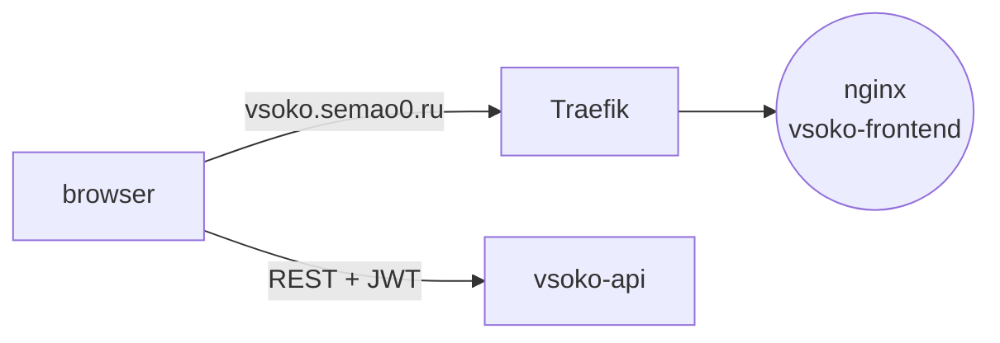

# VSOKO Frontend

Web app: feedback forms for students; criteria, ratings, reports, and AI summaries for admins.

Stack: React 19, TypeScript, Vite, TanStack Query, nginx.

## What it does

One single-page app for both students and admins. Students see their workloads and
rate them. Admins manage criteria, browse ratings and feedback, download the PDF
report, and read AI summaries. The app only talks to `vsoko-api` and is served by
nginx behind the Traefik proxy from `vsoko-infra`.



## Features

- **Separate areas by role** — students and admins get their own navigation; routes are guarded by `ProtectedRoute` / `AdminRoute`.
- **Forced password change** — accounts with a temporary password are sent to `/change-password` until they set a new one.
- **Feedback forms** — score a workload on every criterion and leave a comment; view and edit your own feedback.
- **Admin dashboard** — teacher and course ratings with charts, feedback list, criteria, PDF report, AI summaries.
- **Sessions** — JWT with refresh through axios, server data in TanStack Query, session in Zustand.

### Routes

| Area | Path | Page |
| --- | --- | --- |
| Public | `/login` | sign-in |
| Any user | `/change-password` | password change |
| Student | `/workloads`, `/feedback/new`, `/my-feedback` | workloads, feedback form, own feedback |
| Admin | `/dashboard` | overview |
| Admin | `/teachers`, `/teachers/rating`, `/disciplines`, `/disciplines/rating` | lists and ratings |
| Admin | `/feedback`, `/criteria`, `/summaries`, `/reports` | feedback, criteria, AI summaries, PDF report |

## Quick start

### With Docker

The API URL and page size are baked in at build time:

```bash
docker build \
  --build-arg VITE_API_BASE_URL=http://localhost:8000/api \
  --build-arg VITE_DEFAULT_PAGE_SIZE=10 \
  -t vsoko-frontend .
docker run --rm -p 8001:80 vsoko-frontend
```

In production it runs from `docker-compose.yml` behind Traefik from `vsoko-infra`
and is available at https://vsoko.semao0.ru.

### Locally

```bash
npm install
echo "VITE_API_BASE_URL=http://localhost:8000/api" >  .env.local
echo "VITE_DEFAULT_PAGE_SIZE=10"                     >> .env.local
npm run dev      # http://localhost:5173
npm run build
```

## Structure

```text
vsoko-frontend/
├── Dockerfile             # node build → nginx
├── nginx.conf             # SPA fallback, gzip, static asset caching
└── src/
    ├── api/               # axios client and endpoint wrappers
    ├── components/        # layout, ui, ProtectedRoute, AdminRoute, Pagination, SearchInput
    ├── hooks/             # TanStack Query hooks, pagination
    ├── pages/             # LoginPage, ChangePasswordPage
    │   ├── student/       # workloads, feedback form, my feedback
    │   └── admin/         # dashboard, ratings, teachers, disciplines, criteria, feedback, summaries, reports
    ├── store/             # Zustand stores
    ├── types/             # API types
    └── utils/             # constants, helpers
```
