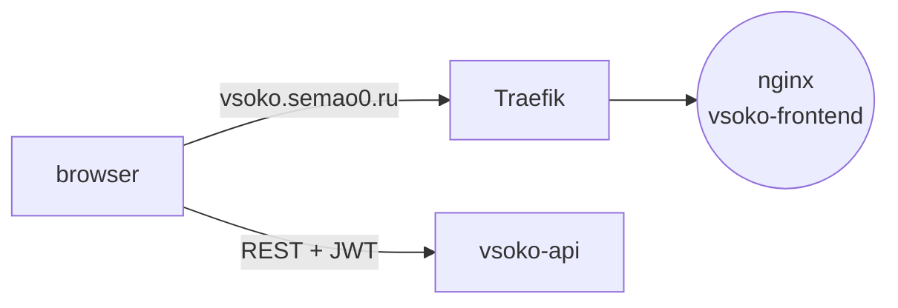

<div align="center">

<a href="https://gitlab.com/vsoko"></a>

# 🖥️ vsoko-frontend

### Web UI: feedback forms for students; criteria, ratings, reports and AI summaries for administrators

[](https://gitlab.com/vsoko/vsoko-frontend/-/pipelines)


<sub>Part of <a href="https://gitlab.com/vsoko"><b>VSOKO</b></a> — an education quality assessment platform running in production at a university</sub>

</div>

---

## Role in the system

The single-page app for both audiences. Students see their workloads and rate them. Administrators
manage evaluation criteria, browse ratings and feedback, download the PDF report and read AI summaries.
The app talks only to [vsoko-api](https://gitlab.com/vsoko/vsoko-api). It is served as static files by nginx
behind the Traefik proxy from [vsoko-infra](https://gitlab.com/vsoko/vsoko-infra).



## Features

- **Role-based areas** — separate navigation for students and administrators; routes guarded by `ProtectedRoute` / `AdminRoute`.
- **Forced password change** — accounts with a temporary password are sent to `/change-password` until they update it.
- **Feedback forms** — rate a workload on every criterion and leave a comment; view and edit your own feedback.
- **Admin dashboard** — teacher and discipline ratings with charts, feedback list, criteria management, PDF report download, AI summaries.
- **Session handling** — JWT with refresh via axios, server state in TanStack Query, session in Zustand.

### Routes

| Area | Path | Page |
| --- | --- | --- |
| Public | `/login` | sign-in |
| Any user | `/change-password` | password change |
| Student | `/workloads`, `/feedback/new`, `/my-feedback` | workloads, feedback form, own feedback |
| Admin | `/dashboard` | overview |
| Admin | `/teachers`, `/teachers/rating`, `/disciplines`, `/disciplines/rating` | lists and ratings |
| Admin | `/feedback`, `/criteria`, `/summaries`, `/reports` | feedback, criteria, AI summaries, PDF report |

## Quick start

**Production** — CI builds the image and deploys it with `docker-compose.yml`; requires `web_network` and Traefik from
[vsoko-infra](https://gitlab.com/vsoko/vsoko-infra). The app is then available at https://vsoko.semao0.ru.

**Standalone image** — the variables are baked in at build time:

```bash
docker build \
  --build-arg VITE_API_BASE_URL=http://localhost:8000/api \
  --build-arg VITE_DEFAULT_PAGE_SIZE=10 \
  -t vsoko-frontend .
docker run --rm -p 8001:80 vsoko-frontend
```

**Local development:**

```bash
npm install
echo "VITE_API_BASE_URL=http://localhost:8000/api" >  .env.local
echo "VITE_DEFAULT_PAGE_SIZE=10"                     >> .env.local
npm run dev      # http://localhost:5173
npm run build    # tsc && vite build
```

| Variable | Purpose |
| --- | --- |
| `VITE_API_BASE_URL` | vsoko-api base URL |
| `VITE_DEFAULT_PAGE_SIZE` | page size for paged lists |

## Structure

```text
vsoko-frontend/
├── Dockerfile             # node build → nginx
├── nginx.conf             # SPA fallback, gzip, static asset caching
└── src/
    ├── api/               # axios client and endpoint wrappers
    ├── components/        # layout, ui, ProtectedRoute, AdminRoute, Pagination, SearchInput
    ├── hooks/             # TanStack Query hooks, pagination
    ├── pages/             # LoginPage, ChangePasswordPage
    │   ├── student/       # workloads, feedback form, my feedback
    │   └── admin/         # dashboard, ratings, teachers, disciplines, criteria, feedback, summaries, reports
    ├── store/             # Zustand stores
    ├── types/             # API types
    └── utils/             # constants, helpers
```
